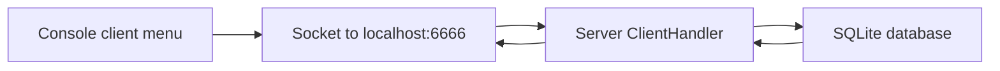

# Mini-Twitter — Early Console Client/Server Prototype

**Java · TCP sockets · SQLite · Educational prototype**

This repository is an early, console-oriented version of the Mini-Twitter coursework. The Java client and server use serialized objects over a socket for operations such as account registration, login, profile access, and social interactions.

## Intended request flow

| Component | Source | Responsibility |
| --- | --- | --- |
| Client | [`src/client/Client.java`](./src/client/Client.java) | Console menu, validation, request formatting |
| Server | [`src/server/Server.java`](./src/server/Server.java) | Socket handling and SQLite access |
| Models | `src/client/`, `src/server/` | User, Tweet, and Profile representations |

The client connects to **port 6666**. The server source implements `Runnable.run()` to listen on that port, but its `main()` method is empty; therefore simply running `server.Server` does **not** start the service as-is. A working server launcher and compatible database must be configured first.

### Relation to the later project

For a richer JavaFX interface and a more complete project structure, see the [later Mini-Twitter repository](https://github.com/Parand1khalili/twitterFinal).

## Status and limitations

This version is preserved as an **early educational prototype**. It has not been independently compiled or executed, is not a secure network service, and must not be deployed with live credentials or personal data. Its user and session handling should undergo security review before reuse.
